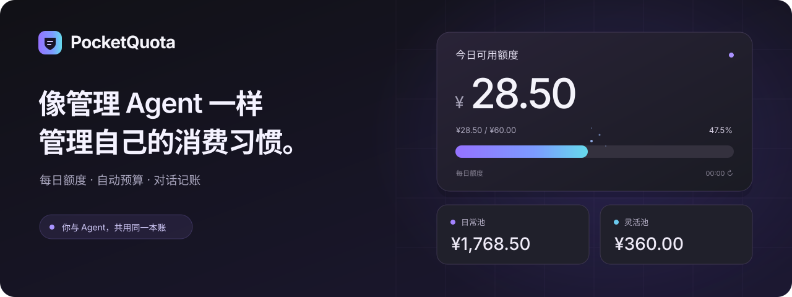
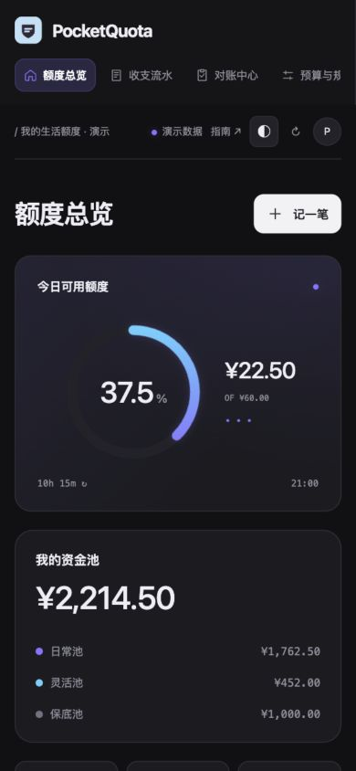

<h1 align="center">PocketQuota v0.2.0 — 扮演一个被邪恶的计划限额的ai</h1>

<p align="center">
  
</p>

<p align="center">
  <a href="https://github.com/ReHowever/pocketquota/actions/workflows/checks.yml"></a>
  &nbsp; <a href="LICENSE">MIT 开源</a>
  &nbsp; · &nbsp; Python 3.11+
  &nbsp; · &nbsp; MCP + REST
  &nbsp; · &nbsp; 自托管
</p>

<p align="center">
  <b>像管理 Agent 一样管理自己的消费习惯。</b><br>
  看见剩余额度，让预算自动运转，让你的 Agent 帮你记账。
</p>

<p align="center">
  <a href="#开始体验">开始体验</a> ·
  <a href="pocketquota/static/guide.html">使用指南</a> ·
  <a href="docs/agents.md">连接 Agent</a> ·
  <a href="https://github.com/ReHowever/pocketquota/releases">下载版本</a>
</p>

---

## 今天，还能自由花多少？

PocketQuota 把这个问题变成一条看得见的额度。

给日常消费设定限额，把节省下来的钱存进灵活池；需要多一点空间时，自动从灵活池补足。你可以随手在网页记一笔，也可以直接告诉自己的 Agent——两边始终共用同一本账。

**日常有边界，灵活有余地。**

## 一个额度面板，掌握消费节奏

| 看见额度 | 让规则运转 | 和 Agent 协作 |
| --- | --- | --- |
| 今日剩余、资金池余额、消费趋势一眼可见 | 每日结余自动划转，补贴与生活费按时入账 | 对话记账、查询预算、核对账目、接收额度提醒 |
| 黑白主题，线形光轨与圆环自由切换 | 补记、撤销、余额调整都有完整记录 | 网页账号与 Agent 共享同一份预算和通知 |

额度随消费变化：扣款时粒子轻轻消散，入账时光带汇入。三套光谱配色，搭配清爽的黑白界面，把每天看预算变成一件舒服的事。

<details>
  <summary><b>查看真实界面 · 深色圆环</b></summary>
  <br>
  
</details>

## 把钱分好，把选择留给自己

| 资金池 | 为你做什么 |
| --- | --- |
| **日常池** | 每天的默认消费来源，用每日限额把握节奏 |
| **灵活池** | 接住每日结余，承接超额消费，也可直接指定使用 |
| **保底池** | 单独留存的一份安心，由你明确安排用途 |

例如：每天额度 **¥60**，今天已经花了 **¥50**，再记一笔 **¥25**。PocketQuota 会自动分配 **日常 ¥10 + 灵活 ¥15**，清楚展示每一分钱的去向。

月底回顾、每日核对、临时调整，都可以在同一个地方完成。CSV 导出支持日期筛选、中文列名和各资金池实际扣款额，方便继续用 Excel 整理。

当可消费预算耗尽，界面会切换为醒目的红色 **“赤字 · 已破产”** 状态，并生成供通知 Agent 领取的额度事件。提醒流程见 [Agent 通知指南](docs/agents.md#通知工作流)。

## 一句话记账，剩下交给规则

```text
“午饭花了 18.5，记日常池。”
“这次旅行的车费 35，走灵活池。”
“今天还剩多少额度？”
“把每日限额改成 60，明天开始。”
“每月 1 号上午 9 点，给日常池记入 1800 生活费。”
```

给你的 Agent 一枚本账号的专用令牌，就能让对话与网页保持同步。按需要选择 **只读、记账、预算管理** 三档权限。

| 你正在使用的工具 | 接入方式 |
| --- | --- |
| Codex | [MCP 配置](integrations/codex.toml) |
| Claude Code / Desktop、Cursor | [MCP 配置](integrations/mcp.json) |
| VS Code Copilot、Gemini CLI | [VS Code 配置](integrations/vscode.mcp.json) · [Gemini 配置](integrations/gemini.settings.json) |
| Hermes 与其他 MCP Agent | [标准 MCP stdio 接入](docs/agents.md#mcp-stdio) |
| DeepSeek / OpenAI-compatible 与自建 Agent | [Function-calling 适配器](docs/agents.md#function-calling) · [REST / OpenAPI](docs/api.md) |

**13 个 MCP 工具，一套统一账本接口。** 配置步骤、工具权限与客户端验证情况集中在 [Agent 接入文档](docs/agents.md)。

## 开始体验

准备 Python **3.11+**，运行三行命令：

```sh
git clone https://github.com/ReHowever/pocketquota.git
cd pocketquota
python3 -m pocketquota.server --demo --data .demo-data
```

打开 [本机演示](http://127.0.0.1:18790/)，点击 **“试用演示账本”**，即可探索完整界面与虚构示例。

准备开始自己的预算时，使用 [正式部署指南](docs/deployment.md)。支持直接运行、Python 安装包与 Docker。

## 自己掌握数据，也掌握规则

- **独立账号**：每个用户拥有自己的账本，Agent 绑定同一账号。
- **随机初始密码**：默认管理员与新建用户均使用随机强密码。
- **可追溯账本**：金额精确到分，自动结算、补记和撤销都有记录。
- **按你的节奏**：日限、生效日、结算时间、月对账日期和定期入账都可配置。
- **开源可扩展**：MIT 许可，标准接口，适合个人使用和继续构建自己的工具。

## 继续探索

[使用指南](pocketquota/static/guide.html) · [部署与备份](docs/deployment.md) · [Agent 接入](docs/agents.md) · [API](docs/api.md) · [设计说明](docs/design.md) · [安全说明](SECURITY.md) · [发布验收](docs/release-check.md)

欢迎分享使用体验、提出功能建议，或通过 [Issue](https://github.com/ReHowever/pocketquota/issues) 与 [Pull Request](https://github.com/ReHowever/pocketquota/pulls) 一起完善 PocketQuota。

---

<p align="center"><b>PocketQuota · 把额度交给规则，把选择留给自己。</b></p>
